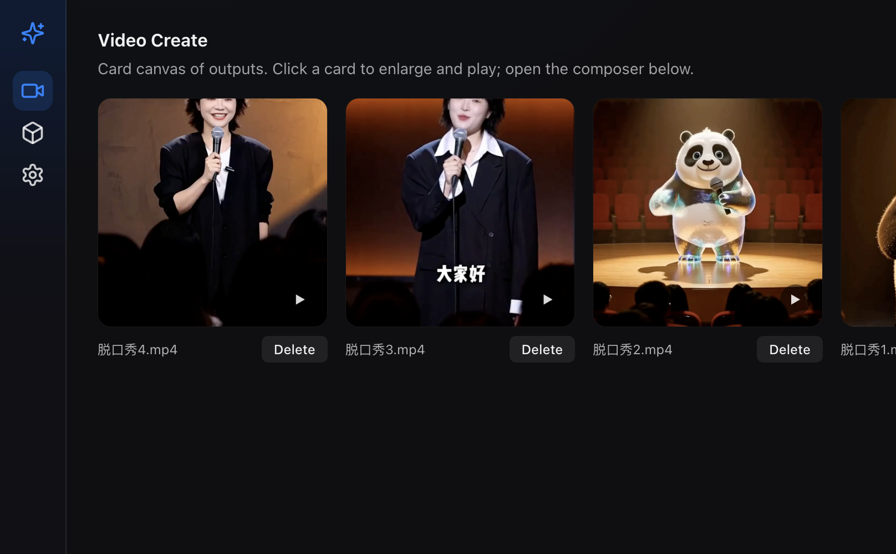

# H3.UI

Language: [English](README.md) | **中文**

[](https://github.com/danmo-ai/h3.c.ui/releases/latest)
[](https://github.com/danmo-ai/h3.c.ui/actions/workflows/ci.yml)
[](LICENSE)

**在 Apple Silicon 上原生跑 MiniMax-H3** — 基于原版 [antirez/h3.c](https://github.com/antirez/h3.c)（Metal CLI 引擎），扩展为 macOS **H3.UI** 产品壳：双语创作工作室、一键模型分包，以及 `~/.h3-ui/` 控制面。



产品名：**H3.UI**。引擎 CLI 仍为 `./h3`（与上游同源）。控制面：`~/.h3-ui/`。

| | |
|---|---|
| **安装** | [GitHub Releases](https://github.com/danmo-ai/h3.c.ui/releases/latest) · `H3.UI_*_aarch64.dmg` |
| **上游引擎** | [antirez/h3.c](https://github.com/antirez/h3.c) — Metal CLI、预设、内核 |
| **引擎详解** | [ENGINE.md](ENGINE.md)（上游 CLI 标志 + 本仓库增量） |
| **UI / API 结构** | [UI.md](UI.md) |
| **设计系统** | [dq-ui](https://github.com/danmo-ai/dq-ui) |

界面模式对齐 [Danmo Make](https://github.com/danmo-ai/danmo-make)：侧栏图标 · 卡片画廊 · 创作抽屉 · 中英双语。

---

## 继承自原版 h3.c（保留）

上游 [antirez/h3.c](https://github.com/antirez/h3.c) 已提供 Metal 核心。本仓库仍以 `libh3` + `./h3` 形式保留：

| 上游基线 | 本仓库仍有 |
|----------|------------|
| 端侧 Metal DiT | `libh3.dylib` + Apple 框架 |
| 文生 / FL2VA / Ref2VA | 同一生成路径 |
| 交互式 CLI | `./h3` 会话（`!first`、`!ref-image`、profile…） |
| 速度 / 内存开关 | SSD streaming · token reduction · int8 row FC2 · Reference RoPE · layers / reuse / `--show` |

完整 CLI 教程见 [ENGINE.md](ENGINE.md)。

---

## 相对原版 h3.c 的扩展（本仓库）

**H3.UI / h3.c.ui** 在上游「仅 CLI」树之上新增：

### 产品壳
| 扩展 | 说明 |
|------|------|
| **桌面端** | Tauri 2 macOS · DMG 发布 · 内置静态 `ffmpeg` / `ffprobe` |
| **创作工作室** | Vue 3 + `@danqing/dq-ui` · 创作 · 下载 · 设置 · 中/英 |
| **本地 API** | Rust `h3-api`（axum）经 FFI 调用引擎 — REST + SSE，不是再起 `./h3` 子进程 |
| **控制面** | `~/.h3-ui/` 配置、上传、输出、下载状态 |

### 引擎增量（CLI 同样可用）
| 扩展 | 说明 |
|------|------|
| **Turbo LoRA** | 可选 8 步适配器（`larryvrh/MiniMax-H3-Turbo-Lora`，约 780 MiB）；创作开关 + `./h3` 标志 |
| **Veda 注意力** | 额外注意力路径；不可与 token reduction 同开 |

### 运维与体验（上游 CLI 没有）
| 扩展 | 说明 |
|------|------|
| **分包下载** | FL2VA · Ref2VA · Turbo LoRA 分开拉（魔搭 / HF 镜像 / Hugging Face） |
| **续传 / 校验** | HTTP Range 断点续传 + SHA-256；取消保留进度 |
| **媒体上传** | 首末帧与 Ref2VA 参考为真文件上传（不是手填路径） |
| **画廊** | 卡片画布 · 灯箱（放大 / 上一条·下一条 / 下载）· 删除 · 可 seek 的 `.mp4` |
| **实时预览** | 任务进行中经 SSE 看去噪中间帧 |
| **失败任务** | 抽屉 + 徽标；`GET /api/tasks/failed` |
| **设置** | 主题、语言、模型/输出目录、HF 仓库 ID、会话权重缓存 |
| **CI / 发布** | `make pack` → GitHub Actions Apple Silicon `.dmg` |

---

## 环境要求

| | |
|--|--|
| **平台** | macOS **Apple Silicon**（主目标） |
| **内存** | 完整 MiniMax-H3 建议 32 GB+ |
| **磁盘** | FL2VA 数十 GB（Ref2VA 另计；Turbo LoRA 约 780 MiB） |
| **源码构建** | Xcode CLT、Rust、Node.js 20+、旁路 [dq-ui](https://github.com/danmo-ai/dq-ui) |

暂未提供 Windows / Linux 桌面包。Metal 引擎面向 Apple Silicon。

---

## 从 Release 安装（推荐）

1. 从 [Releases](https://github.com/danmo-ai/h3.c.ui/releases/latest) 下载 **`H3.UI_*_aarch64.dmg`**。
2. 打开 DMG，将 **H3.UI** 拖入「应用程序」。
3. 首次启动若被拦截（未公证 / 隔离属性），请 **右键 → 打开**，或：

```bash
xattr -dr com.apple.quarantine "/Applications/H3.UI.app"
```

4. 应用内：**下载** → 选择源（国内推荐魔搭）→ 拉取 **FL2VA**（需要时再拉 **Ref2VA** / **Turbo LoRA**）→ **创作**。

---

## 源码快速开始

面向开发者。普通用户请用上面的 Release 安装。

```bash
# 旁路设计系统（前端依赖）
git clone https://github.com/danmo-ai/dq-ui.git
cd dq-ui && npm install && npm run build && cd ..

git clone https://github.com/danmo-ai/h3.c.ui.git
cd h3.c.ui

make ui      # 桌面端（拉取 FFmpeg、构建 API + Tauri）
# make web  # 浏览器 :5810 + API :7810
# make pack # 打包 .app / .dmg
```

| 产品 | 后端 | 前端 |
|------|------|------|
| **H3.UI（本仓库）** | 7810 | 5810 |
| [Danmo Make](https://github.com/danmo-ai/danmo-make) | 7800 | 5800 |
| [Danmo Work](https://github.com/danmo-ai/danmo-work) | 7801 | 5801 |

仅引擎 CLI：

```bash
make -j8
./h3 --info -d ./MiniMax-H3
```

CLI 教程与 Metal 说明见 [ENGINE.md](ENGINE.md)。

---

## 数据目录

| 路径 | 用途 |
|------|------|
| `~/.h3-ui/` | 控制面：`config.json`、下载任务、上传缓存 |
| `~/.h3-ui/models/MiniMax-H3/` | 权重（FL2VA / Ref2VA + Turbo LoRA 适配器） |
| `~/.h3-ui/outputs/` | 生成的 `.mp4` |
| `~/.h3-ui/uploads/` | 首末帧与参考媒体 |

---

## 架构

```
H3.UI (Tauri)  ──►  Vue SPA (@danqing/dq-ui)
                         │  /api
                         ▼
                   h3-api (Rust / axum + SSE)
                         │  FFI
                         ▼
                   libh3.dylib  (Metal MiniMax-H3)
                         │
              内置 ffmpeg / ffprobe
```

---

## 本地 API

基址：`http://127.0.0.1:7810`

| 区域 | 接口 |
|------|------|
| 系统 | `GET /api/system/health` · `device` · `ffmpeg` |
| 模型 | `GET /api/model/status` · `POST /api/model/download` + SSE（`package`：`fl2va` · `ref2va` · `turbo_lora` · `all`） |
| 生成 | `POST /api/generate` · 任务 SSE `/api/tasks/{id}/stream` · 取消 |
| 任务 | `GET /api/tasks/failed` |
| 上传 | `POST /api/uploads` · `GET /api/uploads/{name}/file` |
| 作品 | `GET/DELETE /api/outputs…`（文件 GET 支持 `Range`） |
| 设置 | `GET/PUT /api/settings` |

下载源：`modelscope` · `hf_mirror` · `huggingface`。

---

## 发布 / CI

打标签 `v*` → [release.yml](.github/workflows/release.yml) 在 Apple Silicon runner 上 `make pack` 并发布 `.dmg`。

`main` / PR 走 [ci.yml](.github/workflows/ci.yml)。

---

## 相关项目

- [antirez/h3.c](https://github.com/antirez/h3.c) — 原版 Metal MiniMax-H3 CLI（上游基线）
- [Danmo Make](https://github.com/danmo-ai/danmo-make) — 本地图像 / 视频 / 音频工作室（MLX）
- [Danmo Work](https://github.com/danmo-ai/danmo-work) — 开源 AI 工作代理
- [dq-ui](https://github.com/danmo-ai/dq-ui) — 共享 Vue 设计系统
- [MiniMax-H3](https://huggingface.co/MiniMaxAI/MiniMax-H3) — 模型权重

---

## 许可证

[MIT](LICENSE)
